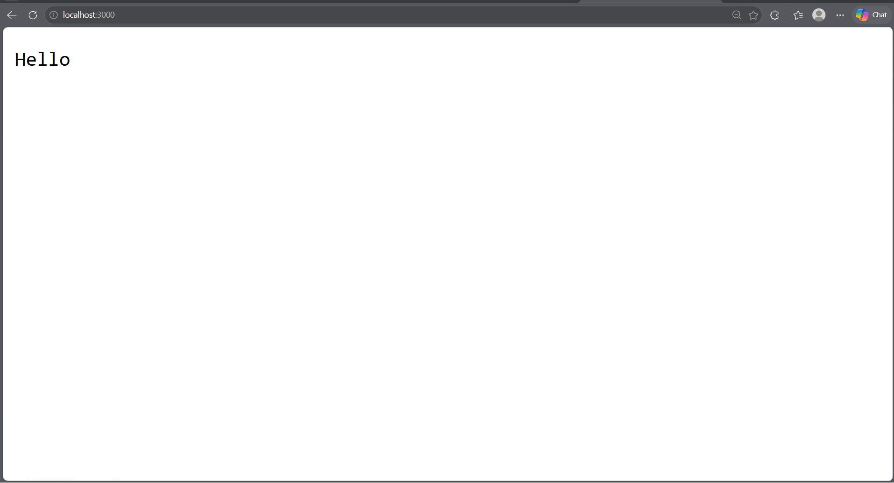
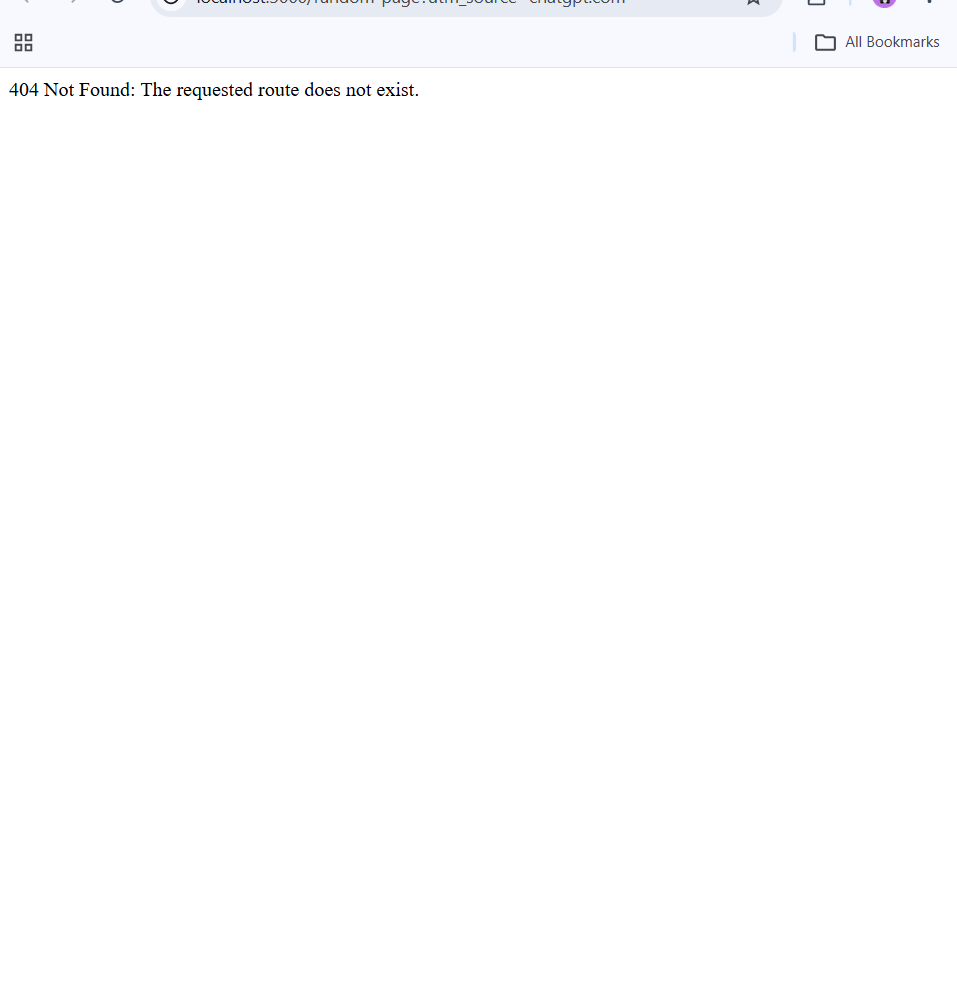

# BDF Lab 01: Node.js and Express Server

## Student Information

- **Student Name:** A. Manishwar Reddy
- **Registration / Roll Number:** 252U1R5011
- **Section:** CSE 1A "(AI & DE)"
- **Course:** Backend Development Frameworks (BDF)
- **Lab Number:** 01

---

## 1. Project Description

This project demonstrates the core fundamentals of building backend servers in Node.js. It is divided into two progressive components:

1. **Low-level HTTP Server:** Implemented using Node.js's built-in `http` module to understand the fundamental request-response cycle and event loop handling in Node.js without third-party frameworks.
2. **Express.js Web Server:** Implemented using the popular, minimalist Express.js framework to demonstrate high-level routing, HTTP status code management, JSON serialization, dynamic date generation, and centralized 404 error handling for unhandled routes.

---

## 2. Explanation of `package.json` Fields

The `package.json` file serves as the manifest for any Node.js project. It maintains project metadata, script commands, and external package dependencies:

| Field | Purpose & Explanation |
| --- | --- |
| `"name"` | Specifies the unique name of the project or package (e.g., `"lab-01"`). Must be lowercase and URL-friendly. |
| `"version"` | Follows Semantic Versioning (`MAJOR.MINOR.PATCH`, e.g., `"1.0.0"`). |
| `"description"` | A concise summary explaining what this package or project accomplishes. |
| `"main"` | The primary entry point file of the application that gets executed when the package is required or started (set to `"server.js"`). |
| `"scripts"` | Key-value dictionary defining shortcut CLI commands that can be executed via `npm run <script-name>`. For instance, `"start": "node server.js"` and `"start:http": "node http-server.js"`. |
| `"keywords"` | An array of strings/tags that describe the project and aid in cataloging or searching. |
| `"author"` | Identifies the author/creator of the project. |
| `"license"` | Identifies the legal licensing terms under which the code is released (e.g., `"ISC"`). |
| `"dependencies"` | Lists third-party npm packages required by the application in production (e.g., `"express": "^5.3.0"`). The `^` (caret) allows npm to install compatible minor and patch updates. |

---

## 3. Project Structure

```text
lab-01/
├── http-server.js      # Basic HTTP server using built-in 'http' module
├── server.js           # Express.js server with routes and 404 handling
├── package.json        # Project metadata and dependencies
├── package-lock.json   # Exact dependency version lockfile
├── .gitignore          # Ignored files (node_modules, .env, logs)
├── screenshots/        # Output screenshots for lab submission
│   └── README.md       # Screenshot guidelines
└── README.md           # Lab documentation and explanations
```

---

## 4. Installation & Setup Instructions

### Prerequisites

- [Node.js](https://nodejs.org/) (v18.x or later installed)
- [npm](https://www.npmjs.com/) (bundled automatically with Node.js)

### Steps

1. Open your terminal and navigate to the project directory:

   ```bash
   cd lab-01
   ```

2. Install project dependencies:

   ```bash
   npm install
   ```

---

## 5. Commands to Run Both Servers

> **Note on Ports:** Both `http-server.js` and `server.js` are configured to run on port `3000` by default. To test them individually, stop the active server using `Ctrl + C` in your terminal before launching the other.

### 5.1 Running the HTTP Server

Using node:

```bash
node http-server.js
```

Or using npm script:

```bash
npm run start:http
```

- **Console Output:** `HTTP Server is running successfully at http://localhost:3000`
- **Response:** Visit `http://localhost:3000` in your browser or run:

  ```bash
  curl http://localhost:3000
  ```

  Expected output: `Hello`

---

### 5.2 Running the Express Server

Using node:

```bash
node server.js
```

Or using npm script:

```bash
npm start
```

- **Console Output:** `Express Server is running successfully at http://localhost:3000`

---

## 6. Endpoint Documentation

### 6.1 HTTP Server (`http-server.js`)

| Method | Endpoint | Status Code | Expected Response |
|---|---|---|---|
| `GET` | `http://localhost:3000/` | `200 OK` | `Hello` |

### 6.2 Express Server (`server.js`)

| Method | Endpoint | Status Code | Description | Sample Response |
| --- | --- | --- | --- | --- |
| `GET` | `/` | `200 OK` | Welcome message text | `Welcome to BDF Lab 01: Node.js and Express Server!` |
| `GET` | `/about` | `200 OK` | JSON object containing student name and section | `{"name":"A. Manishwar Reddy","section":"CSE-1"}` |
| `GET` | `/time` | `200 OK` | Current date and time generated using `new Date()` | `Current Date and Time: Sun Nov 01 2026 18:56:12 GMT+0530 (India Standard Time)` |
| `GET` | `/*` (Unknown path) | `404 Not Found` | Catch-all error message for undefined routes | `404 Not Found: The requested route does not exist.` |

---

## 7. How to Test Endpoints

You can verify the endpoints using `curl` commands in your terminal or by opening the URLs in your web browser.

### In PowerShell / Command Prompt / Terminal

```bash
# 1. Test Root Route (Welcome Text)
curl http://localhost:3000/

# 2. Test About Route (JSON with name & section)
curl http://localhost:3000/about

# 3. Test Time Route (Current Date & Time)
curl http://localhost:3000/time

# 4. Test Unknown Route (404 Error Message)
curl http://localhost:3000/non-existent-page
```

### In PowerShell with Status Code Inspection

```powershell
Invoke-WebRequest -Uri "http://localhost:3000/" | Select-Object StatusCode, Content
Invoke-WebRequest -Uri "http://localhost:3000/about" | Select-Object StatusCode, Content
Invoke-WebRequest -Uri "http://localhost:3000/time" | Select-Object StatusCode, Content
Invoke-WebRequest -Uri "http://localhost:3000/invalid" -SkipHttpErrorCheck | Select-Object StatusCode, Content
```

---

## 8. Screenshot Section

Place your captured verification images inside the `screenshots/` directory and verify they display below:

### 8.1 HTTP Server Output


*Description: HTTP server listening on port 3000 and returning "Hello".*

### 8.2 Express Server - Root (`GET /`)


*Description: Express server returning welcome text with HTTP status 200.*

### 8.3 Express Server - About (`GET /about`)


*Description: Express server returning JSON with student name and section.*

### 8.4 Express Server - Time (`GET /time`)


*Description: Express server returning current date and time using `new Date()`.*

### 8.5 Express Server - 404 Catch-All Handler


*Description: Express server returning 404 Not Found for undefined routes.*

---

## 9. Problems Faced and Solutions

### Problem 1: Port Address Conflict (`EADDRINUSE`)

- **Issue:** Attempting to start both `http-server.js` and `server.js` simultaneously resulted in an `Error: listen EADDRINUSE: address already in use :::3000`.
- **Cause:** Two separate server processes cannot bind to the exact same TCP port (`3000`) on the local network interface at the same time.
- **Solution:**
  1. Stop the currently active server using `Ctrl + C` before running the other server.
  2. In `server.js`, configure `const PORT = process.env.PORT || 3000;`, enabling concurrent testing on another port if required (e.g., `$env:PORT=5000; node server.js`).

### Problem 2: Route Precedence and 404 Catch-All Handler Interception

- **Issue:** If the 404 handler middleware is declared at the top of the file before route definitions, all incoming requests immediately return `404 Not Found`, even valid routes like `/about`.
- **Cause:** Express processes middleware and route handlers sequentially from top to bottom.
- **Solution:** Always position the catch-all middleware (`app.use((req, res) => { ... })`) at the very end of the middleware stack, after all specific route handlers (`/`, `/about`, `/time`) have been registered.

### Problem 3: Distinguishing Plain Text vs. JSON Responses

- **Issue:** Returning JavaScript objects with `res.send()` or incorrect headers can lead to serialization issues or incorrect client-side MIME types.
- **Cause:** Browsers and API clients rely on the `Content-Type` header (`text/plain` vs `application/json`) to properly parse payloads.
- **Solution:** Use Express's specialized `res.status(200).json({ ... })` method for the `/about` endpoint to ensure the response header is automatically set to `application/json; charset=utf-8` and formatted properly.

---

## 10. Live Deployment

- **Deployment Platform:** [Render / Railway / Vercel]
- **Live Application URL:** `[https://your-deployment-link-placeholder.onrender.com]`
- *Note: To deploy live, connect your GitHub repository containing this lab to Render or Railway and set the build command to `npm install` and start command to `node server.js`.*
