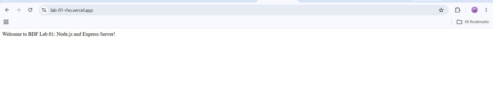
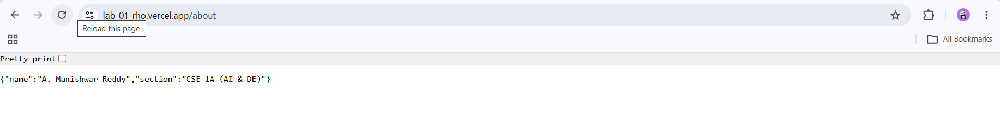
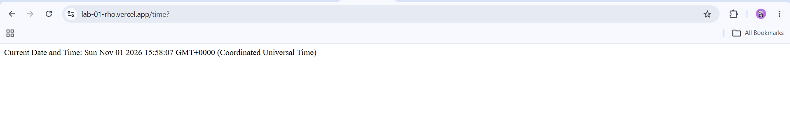

# BDF Lab 01 – Node.js and Express Server

## Student Information

- **Student Name:** A. Manishwar Reddy
- **Roll No:** 252U1R5011
- **Section:** CSE 1A (AI & DE)
- **Course:** Backend Development Frameworks (BDF)
- **Lab Number:** 01
- **GitHub Repository:** [https://github.com/manishwarreddy/BDF-LabS](https://github.com/manishwarreddy/BDF-LabS)
- **Live Application URL:** [https://lab-01-rho.vercel.app](https://lab-01-rho.vercel.app)

---

## 1. Project Description

This project demonstrates the core fundamentals of building backend web servers in Node.js. It is divided into two progressive components:

1. **Low-level HTTP Server:** Implemented using Node.js's built-in `http` module (`http-server.js`) to demonstrate the fundamental request-response cycle and event loop handling without third-party frameworks.
2. **Express.js Web Server:** Implemented using Express.js (`server.js`) to demonstrate declarative routing, HTTP status code handling, JSON serialization, dynamic date generation, and centralized 404 error handling for unhandled routes.

---

## 2. Links & Live Deployment

- **Live Application URL:** [https://lab-01-rho.vercel.app](https://lab-01-rho.vercel.app)
- **GitHub Repository:** [https://github.com/manishwarreddy/BDF-LabS](https://github.com/manishwarreddy/BDF-LabS)
- **Deployment Platform:** Vercel (Fluid Compute Serverless Runtime)
- **Deployment Status:** Deployed & Active

---

## 3. Explanation of `package.json` Fields

The `package.json` file serves as the manifest for any Node.js project. It maintains project metadata, script commands, and external package dependencies:

| Field | Purpose & Explanation |
| --- | --- |
| `"name"` | Specifies the unique name of the project or package (`"lab-01"`). Must be lowercase and URL-friendly. |
| `"version"` | Follows Semantic Versioning (`MAJOR.MINOR.PATCH`, e.g., `"1.0.0"`). |
| `"description"` | A concise summary explaining what this package or project accomplishes. |
| `"main"` | The primary entry point file of the application that gets executed when the package is required or started (set to `"server.js"`). |
| `"scripts"` | Key-value dictionary defining shortcut CLI commands that can be executed via `npm run <script-name>`. For instance, `"start": "node server.js"` and `"start:http": "node http-server.js"`. |
| `"keywords"` | An array of strings/tags that describe the project and aid in cataloging or searching. |
| `"author"` | Identifies the author/creator of the project (`"A. Manishwar Reddy"`). |
| `"license"` | Identifies the legal licensing terms under which the code is released (`"ISC"`). |
| `"dependencies"` | Lists third-party npm packages required by the application in production (`"express": "^5.3.0"`). The `^` (caret) allows npm to install compatible minor and patch updates. |

---

## 4. Project Structure

```text
lab-01/
├── http-server.js      # Basic HTTP server using built-in 'http' module
├── server.js           # Express.js server with routes and 404 handling
├── package.json        # Project metadata and dependencies
├── package-lock.json   # Exact dependency version lockfile
├── .gitignore          # Ignored files (node_modules, .env, logs, .vercel)
├── screenshots/        # Output screenshots for lab submission
│   ├── 02-express-welcome.png
│   ├── 03-express-about.png
│   ├── 04-express-time.png
│   └── README.md
└── README.md           # Lab documentation and explanations
```

---

## 5. Installation & Setup Instructions

### Prerequisites

- [Node.js](https://nodejs.org/) (v18.x or later installed)
- [npm](https://www.npmjs.com/) (bundled automatically with Node.js)

### Steps to Install and Run Locally

1. Open your terminal and navigate to the project directory:

   ```bash
   cd lab-01
   ```

2. Install project dependencies:

   ```bash
   npm install
   ```

3. Start the Express server:

   ```bash
   npm start
   ```

- **Local Server URL:** `http://localhost:3000`

---

## 6. Commands to Run Both Servers

> **Note on Ports:** Both `http-server.js` and `server.js` are configured to run on port `3000` by default. To test them individually, stop the active server using `Ctrl + C` in your terminal before launching the other.

### 6.1 Running the HTTP Server
The basic HTTP server uses Node.js's built-in `http` module and requires no external dependencies.

Using node:

```bash
node http-server.js
```

Or using npm script:

```bash
npm run start:http
```

- **Console Output:** `HTTP Server is running successfully at http://localhost:3000`
- **Response:** Visit `http://localhost:3000` or run `curl http://localhost:3000` $\rightarrow$ `Hello`

---

### 6.2 Running the Express Server
The Express server provides structured routing, HTTP status codes, JSON responses, and centralized error handling.

Using node:

```bash
node server.js
```

Or using npm script:

```bash
npm start
```

- **Console Output:** `Express Server is running successfully at http://localhost:3000`

---

## 7. Endpoint Documentation

### 7.1 HTTP Server (`http-server.js`)

| Method | Endpoint | Status Code | Expected Response |
|---|---|---|---|
| `GET` | `http://localhost:3000/` | `200 OK` | `Hello` |

### 7.2 Express Server (`server.js`)

| Method | Endpoint | Status Code | Description | Sample Response |
| --- | --- | --- | --- | --- |
| `GET` | `/` | `200 OK` | Welcome message text | `Welcome to BDF Lab 01: Node.js and Express Server!` |
| `GET` | `/about` | `200 OK` | JSON object containing student name and section | `{"name":"A. Manishwar Reddy","section":"CSE 1A (AI & DE)"}` |
| `GET` | `/time` | `200 OK` | Current date and time generated using `new Date()` | `Current Date and Time: Sun Nov 01 2026 18:56:12 GMT+0530 (India Standard Time)` |
| `GET` | `/*` (Unknown path) | `404 Not Found` | Catch-all error message for undefined routes | `404 Not Found: The requested route does not exist.` |

---

## 8. How to Test Endpoints

### Local Testing (Terminal / PowerShell / Browser)

```bash
# 1. Test Root Route (Welcome Text)
curl http://localhost:3000/

# 2. Test About Route (JSON with name & section)
curl http://localhost:3000/about

# 3. Test Time Route (Current Date & Time)
curl http://localhost:3000/time

# 4. Test Unknown Route (404 Error Message)
curl http://localhost:3000/non-existent-page
```

### Live Vercel Deployment Testing

```bash
# 1. Test Root Route
curl https://lab-01-rho.vercel.app/

# 2. Test About Route
curl https://lab-01-rho.vercel.app/about

# 3. Test Time Route
curl https://lab-01-rho.vercel.app/time

# 4. Test 404 Catch-All Route
curl -i https://lab-01-rho.vercel.app/invalid-endpoint
```

---

## 9. Verification Screenshots

The following verified output screenshots are stored in [`lab-01/screenshots/`](screenshots/):

### 9.1 Express Server - Welcome Route (`GET /`)

*Description: Browser/client output showing HTTP 200 OK and welcome text.*

### 9.2 Express Server - About Route (`GET /about`)

*Description: JSON response returning student name and section with HTTP 200 OK.*

### 9.3 Express Server - Time Route (`GET /time`)

*Description: Output showing the dynamic current date and time generated using `new Date()`.*

---

## 10. Notes & Technical Key Learnings

- **Built-in `http` vs. `express`:** The built-in Node.js `http` module is lightweight and requires no external dependencies, but routing, query parsing, and status code management must be handled manually. Express provides an abstraction layer with expressive routing (`app.get`), automatic MIME type setting via `res.json()`, and modular middleware.
- **Middleware Ordering for 404 Handling:** Express executes middleware and routes in the sequential order they are registered. The catch-all 404 handler (`app.use((req, res) => { ... })`) is positioned at the very end of `server.js` so it only intercepts requests that do not match any defined endpoint.
- **Serverless Compatibility (Vercel):** To support deployment on Vercel's Fluid Compute without breaking local `npm start` execution, `server.js` exports the app via `module.exports = app;` while wrapping `app.listen()` inside `if (require.main === module)`. This allows local standalone execution on port 3000 while enabling Vercel to invoke the app on demand as a serverless function.
- **Environment Variables:** The application supports an optional `PORT` environment variable (`process.env.PORT || 3000`) for port flexibility during concurrent testing. No sensitive secrets or database credentials are required for this lab.

---

## 11. Problems Faced and Solutions

### Problem 1: Port Address Conflict (`EADDRINUSE`)
- **Issue:** Attempting to start both `http-server.js` and `server.js` simultaneously resulted in an `Error: listen EADDRINUSE: address already in use :::3000`.
- **Cause:** Two separate server processes cannot bind to the same TCP port (`3000`) on the local network interface at the same time.
- **Solution:** Stop the currently active server using `Ctrl + C` before running the other server, or override the port for Express using `$env:PORT=5000; node server.js`.

### Problem 2: Route Precedence and 404 Catch-All Handler Interception
- **Issue:** If the 404 handler middleware is declared at the top of the file before route definitions, all incoming requests immediately return `404 Not Found`, even valid routes like `/about`.
- **Cause:** Express processes middleware sequentially from top to bottom.
- **Solution:** Always position the catch-all middleware at the very bottom of the file after all specific route handlers (`/`, `/about`, `/time`).

### Problem 3: Distinguishing Plain Text vs. JSON Responses
- **Issue:** Returning JavaScript objects without proper headers can lead to serialization issues or incorrect client-side MIME types.
- **Cause:** Browsers and API clients rely on the `Content-Type` header (`text/plain` vs `application/json`) to properly parse payloads.
- **Solution:** Use Express's specialized `res.status(200).json({ ... })` method for the `/about` endpoint to automatically set the response header to `application/json; charset=utf-8`.
